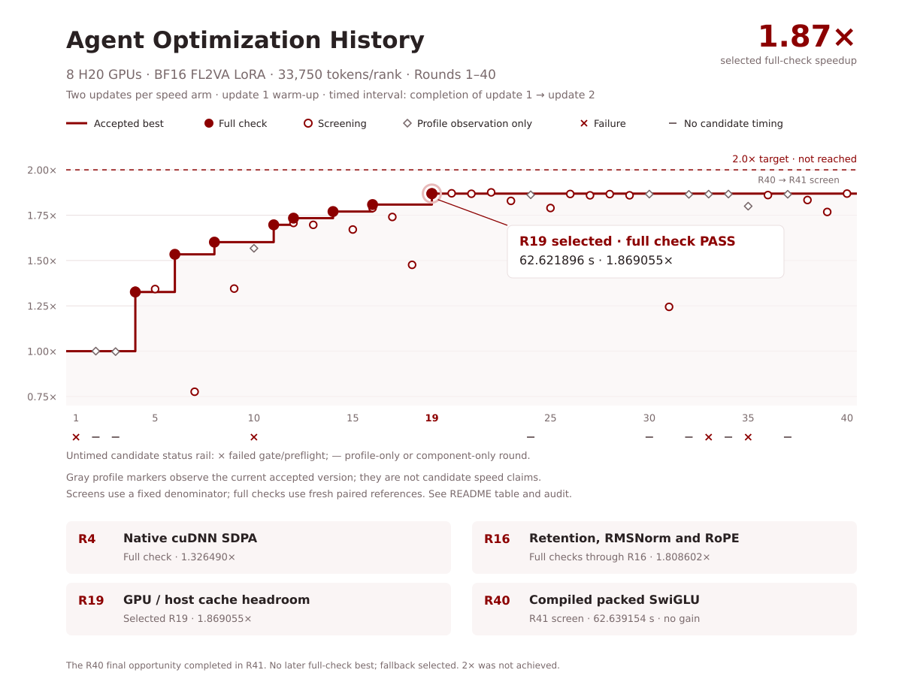

# Faster-MiniMax-H3

[English](README.md) | [简体中文](README_zh.md)

**1.86× faster MiniMax-H3 LoRA fine-tuning optimizer steps on 8×H20 GPUs, optimized by AI agents.**

| Implementation | Time / optimizer step (s) ↓ | Speedup ↑ |
|---|---:|---:|
| Reference | 117.318886 | 1.00× |
| **Faster-MiniMax-H3** | **63.176236** | **1.8570×** |

Measured in the authoritative reference/candidate/reference check with BF16 FL2VA LoRA/ZeRO-3,
batch one per rank and approximately 33,750 tokens per sample. The separate matched three-seed ×
reference/optimized validation ran exactly 50 optimizer steps in all six arms and passed all eight
predeclared comparisons. These are short cached-workload results, not a full-convergence or
generated-output-quality claim.

Faster-MiniMax-H3 is the agent-optimized H20 training path for
[MiniMaxAI/MiniMax-H3](https://huggingface.co/MiniMaxAI/MiniMax-H3). It includes a supervised
rectified-flow trainer built on the official Diffusers integration, latent-cache preprocessing, and the
LoRA × ZeRO-3 correctness fixes documented in [FIXES.md](FIXES.md).

## Quick Start

Prepare Python 3.11, PyTorch ≥ 2.8, the public MiniMax-H3 weights and a JSONL manifest following
[`examples/manifest.example.jsonl`](examples/manifest.example.jsonl):

```bash
bash install_env.sh
python validate_manifest.py --manifest path/to/train.jsonl --check-files
python prepare_cache.py \
  --metadata path/to/train.jsonl --output cache/train \
  --model /path/to/MiniMax-H3 \
  --height 256 --width 256 --frames 22 --encode-text --encode-audio

deepspeed --num_gpus 8 train.py \
  --model /path/to/MiniMax-H3 --variant ref2va \
  --cache cache/train --output runs/lora \
  --max-steps 800 --trainable lora --strategy deepspeed
```

The optimized H20 paths are enabled by default. See `python train.py --help` for cache budgets and
fallback switches. Model constraints include `num_frames % 17 == 5`, dimensions divisible by 32,
24 fps video and 32 kHz stereo audio.

<!-- BEGIN GENERATED OPTIMIZATION HISTORY -->
## Agent Optimization History

Measured on **8×H20**, BF16 FL2VA LoRA/ZeRO-3, batch one per rank and approximately 33,750 tokens per sample. Each speed arm has two optimizer updates: update 1 is warm-up, and the interval to update 2 is timed. **Round 19 was the full-check best of the original Rounds 1–40 at approximately 1.87×, but it later failed the 50-update trajectory gate and is not the released implementation.** The released repair first passed its authoritative full check in Round 50 and was selected at the Round 60 closeout.



**F** = fresh reference/candidate/reference full check (numerics, benefit and integrity). **T** = uninstrumented screening time; a timing PASS alone does not accept a candidate. **P** = profile-only observation, excluded from speed claims. **—** = no valid candidate timing. The T column selects the lowest valid candidate screening latency in each round. Accepted best changes only after F; 1.000000× in rounds 1–3 denotes the unchanged reference anchor.

| Round | Experiment | Best T: seconds / ratio | F or other result | Accepted best at round end |
|---:|---|---:|---|---:|
| 1 | Lock preflight | — | **Failure; no candidate time.** Lock permission error before GPU acquisition; CPU quick passed; no valid timing. | 1.000000× |
| 2 | Unchanged baseline | — | **P only**: 117.026331 s; no candidate time. Baseline observation only; no optimization or full acceptance. | 1.000000× |
| 3 | Nsight baseline observation | — | **P only**: 117.356360 s; no candidate time. Instrumented profile only; raw trace import failed (missing libdw); no optimization. | 1.000000× |
| 4 | Native cuDNN SDPA | 87.829333 / 1.333024× | **F PASS**: 88.074620 s / 1.326490×. Accepted native backend substitution; fresh full check followed the round. | 1.326490× |
| 5 | Strided cuDNN inputs | 87.195134 / 1.342719× | **T only; not accepted.** Rejected: approximately 0.72% versus prior screen, below noise resolution; profiler failure retried separately. | 1.326490× |
| 6 | Checkpoint attention O/LSE retention | 76.372563 / 1.532993× | **F PASS**: 76.148855 s / 1.534143×. Accepted checkpoint-scoped native attention reuse; all 108 tensors passed. | 1.534143× |
| 7 | Memory-efficient attention | 150.820727 / 0.776277× | **T only; not accepted.** Rejected: substantially slower; timing structure PASS is not numerical acceptance. | 1.534143× |
| 8 | Compiled RMSNorm | 73.203333 / 1.599362× | **F PASS**: 73.052049 s / 1.601428×. Accepted; first compile/cache failure retried; no measured-window recompilation. Full check logged compiler cache hits; do not assume every artifact was cold. | 1.601428× |
| 9 | FlexAttention backends | 87.035622 / 1.345180× | **T only; not accepted.** Rejected: standard Flex slower; experimental TMA failed numerics; backend-name launch error has no timing. | 1.601428× |
| 10 | Initial frozen-Linear cache | — | **Failure; no candidate time.** No candidate attempt completed update 1: a stream-lifetime fix and busy preflights preceded a rank SIGKILL. Pinned allocation pressure is suspected. | 1.601428× |
| 11 | Bounded native Linear cache | 69.011473 / 1.696509× | **F PASS**: 69.093446 s / 1.696914×. Accepted 16 GiB GPU / 64 GiB host cache; full check authoritative despite slightly faster standalone screen. | 1.696914× |
| 12 | Fused RoPE and layout | 68.582903 / 1.707110× | **F PASS**: 67.394364 s / 1.733697×. Accepted N0 rotary component / N1 stack. Full check passed the predeclared 68.848 s cutoff; screen/full-check variation is recorded separately. | 1.733697× |
| 13 | cuBLASLt/workspace search | 69.000824 / 1.696771× | **T only; not accepted.** Rejected both default and 128 MiB workspace settings; neither beat accepted cuBLAS. | 1.733697× |
| 14 | Host cache 96 GiB | 66.105282 / 1.771093× | **F PASS**: 66.096057 s / 1.770093×. Accepted 96 GiB host budget; the 160 GiB trial ended in SIGKILL before update 1, without a valid time. | 1.770093× |
| 15 | Packed frozen QKV | 70.068271 / 1.670922× | **T only; not accepted.** Rejected native cuBLAS and cuBLASLt packed variants; both slower. | 1.770093× |
| 16 | Power-of-two pinned slabs | 65.440259 / 1.789091× | **F PASS**: 64.746800 s / 1.808602×. Accepted 176 GiB host / 24 GiB GPU slabs, with all 700 replays. The 112 GiB screen was slower; full check passed the 65.75 s cutoff. | 1.808602× |
| 17 | NUMA placement | 67.278752 / 1.740202× | **T only; not accepted.** Rejected: slower; instrumented operator durations are not additive critical-path evidence. | 1.808602× |
| 18 | DeepSpeed communication overlap | 79.312700 / 1.476165× | **T only; not accepted.** Both overlap trials rejected; even the best was slower. Extra headroom alone did not recover performance. | 1.808602× |
| **19 · original-stage best** | Cache headroom: 16 GiB GPU / 184 GiB host | 62.636536 / 1.869174× | **F PASS**: 62.621896 s / 1.869055×. Original-stage protected commit `fe2ccd6`; all 700 expected cache replays, no misses. Later 50-update validation failed, so this is not the released implementation. | **1.869055×** |
| 20 | Grouped block parameter fetch | 62.586782 / 1.870660× | **T only; not accepted.** Only 0.056% lower latency than the accepted result: unresolved, with no full check or new accepted best. | 1.869055× |
| 21 | Sequential/grouped fetch | 62.670310 / 1.868167× | **T only; not accepted.** Rejected: no gain. All-reduce alternative rejected before timing for unsupported dtype/padding assumptions. | 1.869055× |
| 22 | Compiled modulated RMSNorm | 62.412514 / 1.875883× | **T only; not accepted.** Only 0.334% lower latency; missed the predeclared 61.5 s cutoff. No full check. | 1.869055× |
| 23 | Attention head folding | 64.016940 / 1.828869× | **T only; not accepted.** Head group 1 was slower; group 8 had component PASS but no timing. Nsight trace import failed. | 1.869055× |
| 24 | Repaired native Flex TMA components | — | **No candidate time** (accepted-best P only). Component/operator/opcheck PASS only; no candidate end-to-end time. Accepted-best profile is observation only. | 1.869055× |
| 25 | Flex TMA/CuDNN hybrid forward | 65.424116 / 1.789533× | **T only; not accepted.** Rejected default and tile-128 configurations; actual fast paths were active but slower. | 1.869055× |
| 26 | Small parameter persistence | 62.712242 / 1.866918× | **T only; not accepted.** Rejected: persistence fast path active but no gain; independent updated-shard freshness passed. | 1.869055× |
| 27 | Native fetch/prefetch configuration | 62.962044 / 1.859511× | **T only; not accepted.** Rejected: grouped leaf failed fixed FP64 norm bound (3.2577 > 3); corrected no-leaf trial passed numerics but was slower. | 1.869055× |
| 28 | Classic cuBLAS 128 MiB workspace | 62.736147 / 1.866206× | **T only; not accepted.** Rejected: production/training numerical gates passed; frozen timing showed no gain. | 1.869055× |
| 29 | Frozen Linear backward weight layout | 62.956861 / 1.859664× | **T only; not accepted.** Rejected: native contiguous weight-transpose gradient fast path active but slower. | 1.869055× |
| 30 | Native cuDNN plan wrapper | — | **No candidate time** (accepted-best P only). Component-only engine 1/index 1 PASS; no trainer timing. The default wrapper selected the existing engine, not a new gain. | 1.869055× |
| 31 | cuDNN engine 1/index 1 | 94.079174 / 1.244469× | **T only; not accepted.** Rejected: actual selected native backward plan active but much slower. | 1.869055× |
| 32 | cuDNN engine 2 knob inventory | — | **No candidate time** (accepted-best P only). Only existing config 26 supported among 0..35; no new eligible candidate and no candidate timing. | 1.869055× |
| 33 | cuDNN engine 0/3 probes | — | **Failure; no candidate time.** Engine 0 unsupported; engine 3/config 31 built but execution returned CUDNN_STATUS_INTERNAL_ERROR; no candidate timing. | 1.869055× |
| 34 | Native FA3 compiler/ABI feasibility | — | **No candidate time** (accepted-best P only). Compiler/ABI feasibility only, with corrected build issues; no native attention execution or candidate timing. | 1.869055× |
| 35 | Native FA3 forward runtime | — | **Failure; no candidate time.** FP64/single-thread component PASS, but concurrent cold-call wrapper failed context/factory gates; no integration or candidate timing. | 1.869055× |
| 36 | Native FA3 forward/CuDNN backward | 62.912493 / 1.860975× | **T only; not accepted.** Rejected: full production path active, no gain; no full check. | 1.869055× |
| 37 | Native FA3 backward components | — | **No candidate time** (accepted-best P only). ABI/TMA/factory/runtime/FP64 component gates passed; no trainer integration or candidate timing. | 1.869055× |
| 38 | Native FA3 M80 backward | 63.850828 / 1.833627× | **T only; not accepted.** Rejected: matched eight-rank numerical fixture passed; native production backward active but slower. | 1.869055× |
| 39 | Native FA3 M64 backward | 66.227518 / 1.767824× | **T only; not accepted.** Rejected: native M64 path active but slower; fast-exp/global-fast-math hypothesis rejected before policy change. | 1.869055× |
| 40 | Compiled packed SwiGLU | 62.639154 / 1.869096× (R41) | **T only; not accepted.** Repaired FP32 SiLU opmath passed component/integration gates. No timing in R40; the terminal R41 screen was slower and triggered fallback. No new full-check best. | 1.869055× |

R40 includes its candidate’s terminal R41 screen; no new accepted best followed. Full-check ratios use their fresh paired-reference mean; screening ratios use the frozen reference. Profile observations and failed/missing runs never advance the accepted curve. See [data and artifact hashes](docs/performance-data/rounds-01-40.json), [denominators, cutoffs and selection audit](docs/performance-audit.md), and the [generator](docs/performance-views/generate_history.py).

Reproduce the figure and table with `python docs/performance-views/generate_history.py`; verify checked-in outputs with `python docs/performance-views/generate_history.py --check`.

Original Round 19 matched 50-update, three-seed trajectory gate: **FAIL**. See the [historical validation results](docs/validation-results.md). The repaired Round 50 release passed the fresh six-arm validation summarized below.
<!-- END GENERATED OPTIMIZATION HISTORY -->

## What changed

- **Attention:** cuDNN SDPA replaces the reference attention path. Checkpoint-local output/LSE retention
  avoids backward recomputation, while fused RoPE and input layout remove separate launch and layout costs.
- **Frozen Linear caching:** selective checkpointing caches eligible frozen GEMM outputs in a bounded
  184 GiB host / 16 GiB GPU arena per rank, using pinned power-of-two slabs, asynchronous copies and prefetch.
- **RMSNorm and replay correctness:** compiled RMSNorm accelerates the hot path. The released repair makes
  checkpoint inference and replay share one detached compiled Q/K forward while retaining the compiled
  first-order derivative, eliminating the observed mode-dependent Q/K mismatch.
- **Guardrails:** unsupported shapes fall back to native operations; runtime counters report cache hits,
  fallbacks and peak allocation; frozen numerical checks cover all 108 trainable LoRA tensors.

These are cumulative configuration changes, not isolated ablations. See the
[performance audit](docs/performance-audit.md), [repair rounds](docs/repair-results.md), and
[machine-readable selection evidence](docs/performance-data/repaired-selection.json).

## Validation: why Round 19 failed and Round 50 passed

The original Round 19 candidate passed its two-update speed check at **1.869055×**, but failed the
predeclared three-seed trajectory gate. Across seeds 424242, 424243 and 424244, both reference and optimized
arms ran exactly 50 optimizer steps and recorded total loss, video loss, audio loss and full trainable LoRA
pre-clip gradient L2 at steps 25 and 50. The optimized arm showed intermittent finite gradient spikes:
at step 25 its mean gradient L2 was **895,829.90** versus **10.68** for reference, giving an absolute
standardized mean difference of **142,950.33**; seed 424243 also reached **11,248,900.41** at step 18 versus
**5.95** for reference. Gradient clipping kept updates finite, but did not make the trajectory gate pass.

Targeted replay diagnostics then found a concrete checkpoint invariant defect: on five of eight ranks,
identical Q/K RMSNorm inputs, weights, epsilon and strides produced different compiled outputs because
inference and replay selected different XBLOCK variants. The repair makes both checkpoint modes share the
same detached compiled Q/K forward and preserves the existing compiled first-order derivative. This fixes
the demonstrated mismatch; it does not claim that the mismatch was necessarily the only cause of every
historical spike.

The repaired candidate first completed an authoritative full speed check in **Round 50** and was selected
at the Round 60 closeout. Its check measured **63.176236 s/step** against **117.318886 s/step**, or
**1.8570097438×**. A fresh six-arm validation then reran reference and repaired implementations for exactly
50 steps at the same three seeds. All values were finite, all fingerprints/contracts matched, and all eight
fixed comparisons passed `|standardized mean difference| ≤ 2.0`:

| Metric | Step 25 | Step 50 | Gate |
|---|---:|---:|---|
| Total loss | -0.031530 | +0.191572 | PASS |
| Video loss | +0.000087 | -0.061845 | PASS |
| Audio loss | -0.033384 | +1.469818 | PASS |
| Full LoRA gradient L2 | -0.068377 | +0.177239 | PASS |

The public runtime commit is [`7d7be36`](https://github.com/2018cx/Faster-MiniMax-H3/commit/7d7be367a2611193b354570a909c8fcc85216394),
whose tree matches audited commit `5c47dee7974a8b69990f05ab4e32cf298bf4ee7e`. Full raw and aggregate evidence is
in the [original failed validation](docs/validation-results.md), [repair audit](docs/repair-results.md), and
[repaired validation](docs/repaired-validation-results.md). This 50-step test establishes short-trajectory
agreement only; it is not a full-convergence or generated-output-quality claim.

## Legal

Model weights are governed by the [MiniMax H3 Community License](https://huggingface.co/MiniMaxAI/MiniMax-H3/blob/main/LICENSE)
(territory and usage restrictions apply; fine-tuned weights are Model Derivatives). This repository contains
code only — no model weights and no training media.

Licensing scope: upstream-derived trainer code has no declared software license; separable new additions are identified without an additional license grant. Model-weight terms remain separate. See [LICENSE](LICENSE), [NOTICE](NOTICE), and the [provenance map](docs/licensing-provenance.json).
